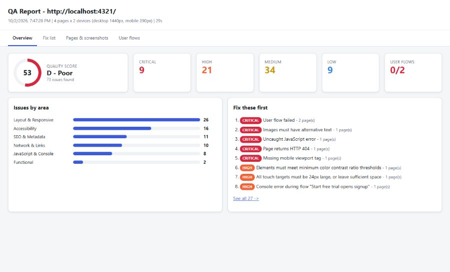

# QA Automation

[](.github/workflows/ci.yml)


Automated QA for websites and web apps, as a hosted SaaS and a command-line tool. Point it at a URL and it crawls the site, tests every page on desktop, tablet and mobile in a real browser, and produces a report with annotated screenshots showing what is broken, where it is, and how to fix it.

It tests the rendered app the way a user sees it, so it works with any stack that runs in a browser, whatever language the backend is written in.



## Features

- **Crawler** that discovers pages by following links, with include/exclude filters and depth limits
- **Multi-device testing** at desktop (1440px), laptop, tablet and mobile sizes, with touch emulation
- **Annotated screenshots**: every problem gets a numbered box on the full-page screenshot, plus a close-up image of each issue
- **Checks across 9 areas**

  | Area | Examples |
  |---|---|
  | Functional | Pages that fail to load, scripted user flows (login, forms, checkout) |
  | JavaScript | Uncaught exceptions, console errors and warnings |
  | Network | 4xx/5xx responses, failed requests, broken links and images, mixed content |
  | Layout | Horizontal overflow, overlapping controls, clipped text, small tap targets, distorted images |
  | Accessibility | WCAG 2.2 A/AA via axe-core (contrast, labels, alt text, ARIA) |
  | Performance | Load time, LCP, CLS, page weight, oversized images |
  | SEO | Title, meta description, H1, heading order, lang, Open Graph, noindex |
  | Visual regression | Pixel diff against approved baseline screenshots |
  | AI review (optional) | Claude reviews screenshots for alignment, consistency, copy and UX problems |

- **Reports** as interactive HTML, Markdown (for tickets) and JSON (for tooling)
- **CI friendly**: exits with code 1 when critical issues are found

## Two ways to use it

| | Hosted web app (SaaS) | Command line |
|---|---|---|
| For | Your customers | Developers and CI pipelines |
| How | Sign up, paste a URL, click **Start scan** | `node bin/qa.js https://site.com` |
| Includes | Accounts, scan history, plans and Stripe billing, API tokens, shareable reports | Full scanner with config files and local reports |

## Hosted web app

### Run it locally

Requires Node.js 22.13 or newer.

```bash
git clone https://github.com/hasipfaruk/QA-Automation.git
cd QA-Automation
npm install
npm run setup          # downloads Chromium for Playwright
cp .env.example .env   # optional: adjust settings
npm start
```

Open http://localhost:3000, create an account and run a scan. Without Stripe keys the app runs in development mode and the Billing page lets you switch plans freely to try every feature.

### Features

- **Accounts**: sign up, log in, change password, delete account. Passwords are hashed with scrypt; sessions are stored server-side in HTTP-only cookies.
- **Dashboard**: paste a URL, pick devices and options, watch live progress, read the result.
- **Scan history**: every scan is saved with score and issue counts. Full reports open from private share links.
- **Plans and billing**: Free, Pro and Business plans with monthly scan limits, enforced on every request. Payments, upgrades and cancellations run through Stripe Checkout and the Stripe customer portal.
- **REST API and API tokens**: start scans from CI or any programming language. Examples are on the in-app API page.
- **User flows and login steps** (paid plans): scripted journeys such as checkout or search, plus login steps for pages behind authentication.

### Plans

Limits live in [`server/plans.js`](server/plans.js). Change them there.

| | Free | Pro | Business |
|---|---|---|---|
| Scans per month | 10 | 200 | 1,500 |
| Pages per scan | 5 | 50 | 200 |
| Devices | desktop, mobile | all 4 | all 4 |
| Parallel scans | 1 | 2 | 4 |
| User flows, login, visual regression, AI review | - | yes | yes |
| Report retention | 7 days | 30 days | 90 days |

### Setting up Stripe

1. In the Stripe dashboard create two products with monthly recurring prices (Pro and Business). Copy their price IDs (`price_...`).
2. Set `STRIPE_SECRET_KEY`, `STRIPE_PRICE_PRO` and `STRIPE_PRICE_BUSINESS` in `.env`.
3. Add a webhook endpoint pointing to `https://your-domain/stripe/webhook` with the events
   `checkout.session.completed`, `customer.subscription.created`, `customer.subscription.updated` and `customer.subscription.deleted`.
   Put its signing secret in `STRIPE_WEBHOOK_SECRET`.
4. Turn on the customer portal in Stripe (**Settings > Billing > Customer portal**) so users can change or cancel plans.

For local testing use the Stripe CLI: `stripe listen --forward-to localhost:3000/stripe/webhook`.

### REST API

Create a token on the **API** page, then:

```bash
curl -X POST https://your-domain/api/v1/scans \
  -H "Authorization: Bearer $QA_TOKEN" \
  -H "Content-Type: application/json" \
  -d '{"url": "https://staging.example.com", "viewports": ["desktop", "mobile"], "maxPages": 10}'

curl https://your-domain/api/v1/scans/SCAN_ID -H "Authorization: Bearer $QA_TOKEN"
```

| Endpoint | Description |
|---|---|
| `GET /api/v1/me` | Plan and monthly usage |
| `POST /api/v1/scans` | Start a scan. Fields: `url`, `viewports`, `maxPages`, `checkExternalLinks`, `ai`, `visual` (`off`, `compare`, `update`), `flows`, `login` |
| `GET /api/v1/scans` | List scans (`limit`, `offset`) |
| `GET /api/v1/scans/:id` | Status, score, summary, `reportUrl`, `markdownUrl` |
| `POST /api/v1/scans/:id/rerun` | Run the same scan again |
| `DELETE /api/v1/scans/:id` | Delete a scan and its report |

Errors return JSON `{ "error": "..." }`. Status `402` means the request needs a higher plan; `429` means a limit was hit.

### Deploying

The included `Dockerfile` is based on the official Playwright image, so Chromium and its system libraries are already installed.

```bash
cp .env.example .env    # set APP_URL, NODE_ENV=production, Stripe keys
docker compose up -d --build
```

Works on any host that runs Docker containers with a persistent volume (a VPS, Railway, Render, Fly.io and similar). Put it behind HTTPS and set `TRUST_PROXY=true` when a proxy or load balancer sits in front.

The SQLite database, reports and baselines live in `DATA_DIR` (`/data` in Docker). Back up that folder.

To scale, run one web process (`ROLE=web`) and one or more scanner processes (`ROLE=worker`) on the same machine and data folder.

### Security model

Scanning URLs that users submit is risky for the server, so the hosted app is locked down:

- **Network isolation**: in production every browser request goes through a built-in egress proxy ([`src/net/egress-proxy.js`](src/net/egress-proxy.js)). It resolves each host and refuses loopback, private, link-local and cloud metadata addresses, including after redirects. `ALLOW_PRIVATE_URLS` must stay `false` on a public server.
- **Restricted flows**: user flows cannot upload server files or read server environment variables.
- **Sandboxed reports**: reports are served from unguessable links with a `sandbox` Content-Security-Policy, so report scripts cannot access the app session.
- **Web security**: CSRF tokens on every form, strict CSP, rate-limited login, hashed API tokens and sessions, open-redirect protection.
- Use dedicated test accounts for login steps. Credentials in scan options are stored in the database so scans can be re-run.

## Command line

After `npm install` and `npm run setup`, run the bundled demo. It serves a small site that has bugs on purpose, then tests it:

```bash
npm run demo -- --open
```

### Usage

```bash
node bin/qa.js https://example.com --open
```

| Option | Description |
|---|---|
| `-c, --config <file>` | JSON config file (defaults to `./qa.config.json` if present) |
| `-p, --max-pages <n>` | Maximum pages to crawl (default 15) |
| `-d, --max-depth <n>` | Maximum link depth from the start URL (default 3) |
| `-v, --viewports <list>` | Comma separated: `desktop,laptop,tablet,mobile` |
| `--only <url>` | Test only this URL, no crawling (repeatable) |
| `--ai` | Enable the Claude screenshot review (needs `ANTHROPIC_API_KEY`) |
| `--visual` | Compare screenshots against saved baselines |
| `--update-baseline` | Save the current screenshots as the new baselines |
| `--no-external` | Skip checking external links |
| `--headed` | Show the browser window while testing |
| `--concurrency <n>` | Number of pages tested in parallel (default 3) |
| `-o, --out <dir>` | Output directory (default `reports`) |
| `--open` | Open the HTML report when finished |

Examples:

```bash
# Local dev server, phones only
node bin/qa.js http://localhost:5173 -v mobile

# Specific pages only
node bin/qa.js --only https://example.com/pricing --only https://example.com/checkout

# Visual regression
node bin/qa.js https://example.com --update-baseline   # first run: approve baselines
node bin/qa.js https://example.com --visual            # later runs: compare
```

### Configuration

Copy [`qa.config.example.json`](qa.config.example.json) to `qa.config.json` and adjust it. The main sections are:

- `auth`: log in once before testing, either with `loginUrl` and `steps` or with a saved Playwright `storageState`. Use `${ENV:NAME}` to read secrets from environment variables so passwords never live in the file.
- `flows`: scripted user journeys. Each step is one action:
  `goto`, `click`, `fill`, `type`, `select`, `check`, `uncheck`, `hover`, `press`, `upload`, `wait`,
  `expectText`, `expectNoText`, `expectVisible`, `expectUrl`.
  Selectors can be CSS (`#email`) or Playwright text selectors (`text=Sign in`).
- `thresholds`: performance and usability limits (load time, LCP, CLS, page weight, tap target and font sizes).
- `ai`: model, effort and `maxScreens`, which caps how many page/device combinations are sent for review.
- `visual`: diff `threshold` in percent of changed pixels and the `baselineDir`.
- `failOn`: `critical`, `high` or `none`, which controls the exit code.

### Output

Each run writes to `reports/<host>_<timestamp>/`:

| File | Contents |
|---|---|
| `report.html` | Overview score, prioritised fix list, page-by-page annotated screenshots, user flow steps |
| `REPORT.md` | The fix list in Markdown, ready to paste into Jira or GitHub issues |
| `results.json` | Raw results for dashboards or other tools |
| `screenshots/` | Clean and annotated full-page captures, issue close-ups, flow steps, visual diffs |

## Roadmap

- [x] Web app scanning across desktop, tablet and mobile
- [x] Accessibility, layout, network, performance and SEO checks
- [x] Scripted user flows with login support
- [x] Visual regression and AI screenshot review
- [ ] API testing (REST and GraphQL)
- [ ] Scheduled monitoring with alerts
- [x] Hosted web app with accounts, scan history, plans, billing and REST API
- [ ] Team workspaces and email notifications
- [ ] Password reset by email

## Website

The product landing page lives in [`docs/`](docs/index.html) as plain HTML, CSS and JavaScript. To publish it, enable GitHub Pages in **Settings > Pages** with source `main` and folder `/docs`.

## Project structure

```
bin/qa.js                     CLI entry point
src/runner.js                 crawler and per-page test pipeline
src/checks/inpage.js          layout, image, SEO, performance and link checks (run in the page)
src/checks/accessibility.js   axe-core scan
src/checks/visual.js          baseline screenshot comparison
src/checks/ai-review.js       Claude screenshot review
src/flows.js                  login and scripted user flows
src/rules.js                  titles, severities and fix guidance for every check
src/report/                   scoring, HTML and Markdown reports
src/net/egress-proxy.js       network filter that keeps scans on the public internet
server/                       hosted web app: routes, auth, scans, worker, billing, views
server/plans.js               plan limits
test/                         unit and integration tests (`npm test`)
demo/                         demo site with known bugs
docs/                         product landing page (also served by the web app)
Dockerfile                    production image
```

## License

[MIT](LICENSE)
